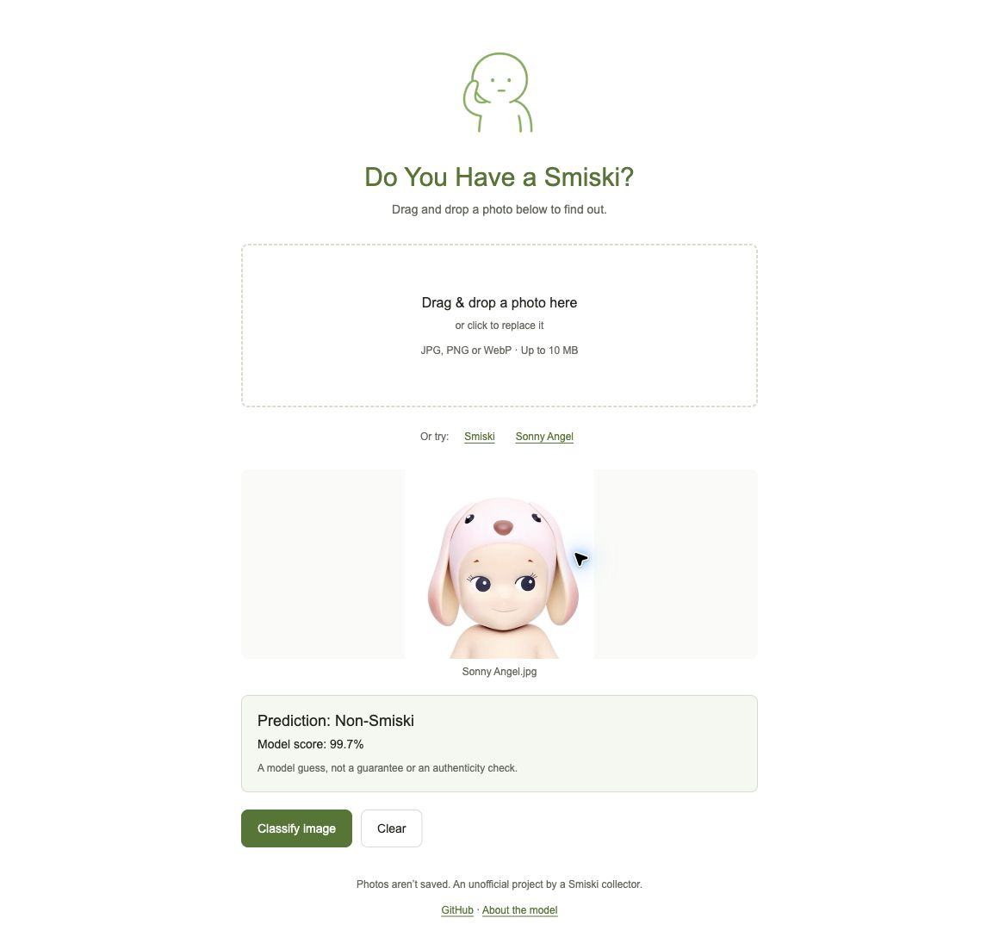

# Is It a Smiski?

A collector's take on computer vision. Upload a photo or try an example to see whether a ResNet50 model recognizes a Smiski.

Built with **Next.js**, **Flask**, and **PyTorch**, with a simple interface that keeps the focus on your photo. Images are processed in memory and never saved.



## Run locally

The app is not deployed yet. Run the API and frontend in two terminals.

### 1. First-time setup

Install **Python 3.11**, **Node.js 22** (includes npm), and [uv](https://docs.astral.sh/uv/getting-started/installation/), then clone the repository:

```sh
git clone https://github.com/giomhern/is-it-a-smiski.git
cd is-it-a-smiski
```

If you already have the repository, open its root directory. Install dependencies and download the model:

```sh
uv sync --locked
npm --prefix frontend ci
test -f .env || cp .env.example .env
test -f frontend/.env.local || cp frontend/.env.example frontend/.env.local
uv run --locked python -m scripts.install_model
```

These commands keep existing environment files. The installer downloads about 90 MB of checksum-verified weights from the [model release](https://github.com/giomhern/is-it-a-smiski/releases/tag/model-v1). No training data or Flickr credentials are needed to run the app. Linux installs use CPU-only PyTorch automatically through `uv`; no CUDA setup is needed.

### 2. Start the API — terminal 1

From the repository root:

```sh
uv run --locked python -m backend.api.app
```

Leave it running at http://localhost:5050. Check readiness at http://localhost:5050/health; it should return `{"status":"ok"}`.

### 3. Start the frontend — terminal 2

From the repository root:

```sh
npm --prefix frontend run dev
```

Open **http://localhost:3000**, choose an example or upload a photo, then click **Classify**. Keep both terminals running; press `Ctrl+C` in each to stop. On later runs, repeat only steps 2 and 3.

### If something does not work

- **Model missing:** rerun `uv run --locked python -m scripts.install_model` from the repository root.
- **Cannot reach the API:** check that it is running on port 5050 and `frontend/.env.local` contains `NEXT_PUBLIC_API_URL=http://localhost:5050`. Restart the frontend after editing it.
- **Port already in use:** stop the existing process on 3000 or 5050. Use `localhost:3000` so the browser origin matches the default API configuration.

## API

`GET /health` checks readiness. `POST /api/predict` accepts one multipart `image` (JPEG, PNG, or WebP; up to 10 MiB and 40 megapixels) and returns a prediction, confidence, and both class scores.

```sh
curl -f -F image=@tests/smiski/test-smiski.jpeg http://localhost:5050/api/predict
```

## Model

The default checkpoint has unknown training provenance; its scores are uncalibrated. A separate frozen-ImageNet baseline reached 94.52% accuracy on 146 folder-labeled test photos, but labels are imperfect and it fails the included Sonny Angel example. This is preliminary evidence, not a real-world accuracy claim or authenticity check. See the short [model card](docs/MODEL_CARD.md).

## Training and evaluation

Training is optional and requires local photos in `data/raw/{smiski,non_smiski}/` (or `DATA_DIR`). Generated splits, reports, and training metadata stay outside Git.

```sh
uv run --locked python -m scripts.prepare_dataset
uv run --locked python -m scripts.train_model --output backend/models/my_model.pt
uv run --locked python -m scripts.evaluate_model \
  --checkpoint backend/models/my_model.pt --output data/evaluation/my_model.json
```

Scripts refuse to overwrite existing results. Training uses only train/validation partitions; evaluation checks checkpoint and split provenance. Use a new snapshot/output path for a changed dataset and a fresh test set after tuning on previous test results.

The original v1 split is preserved unchanged in [Git history](https://github.com/giomhern/is-it-a-smiski/blob/8723cbaf84d39f44c37dfa79cd3737099bfc3faf/docs/dataset/split-v1.json). To reproduce that run with the original photos, download it instead of creating a new split:

```sh
mkdir -p data/splits
curl --fail --location --output data/splits/split-v1.json \
  https://raw.githubusercontent.com/giomhern/is-it-a-smiski/8723cbaf84d39f44c37dfa79cd3737099bfc3faf/docs/dataset/split-v1.json
```

Historical reports and baseline metadata are archived with the [model release](https://github.com/giomhern/is-it-a-smiski/releases/tag/model-v1).

## Checks

```sh
uv run --locked python -m unittest discover -s tests/unit -v
cd frontend
npm run lint
npm run typecheck
npm test
npm run build
```

Inference tests require the installed checkpoint. Contribution and coding standards live in [AGENTS.md](AGENTS.md).

Independent fan project; unaffiliated with [Smiski](https://smiski.com/e/smiski/).
